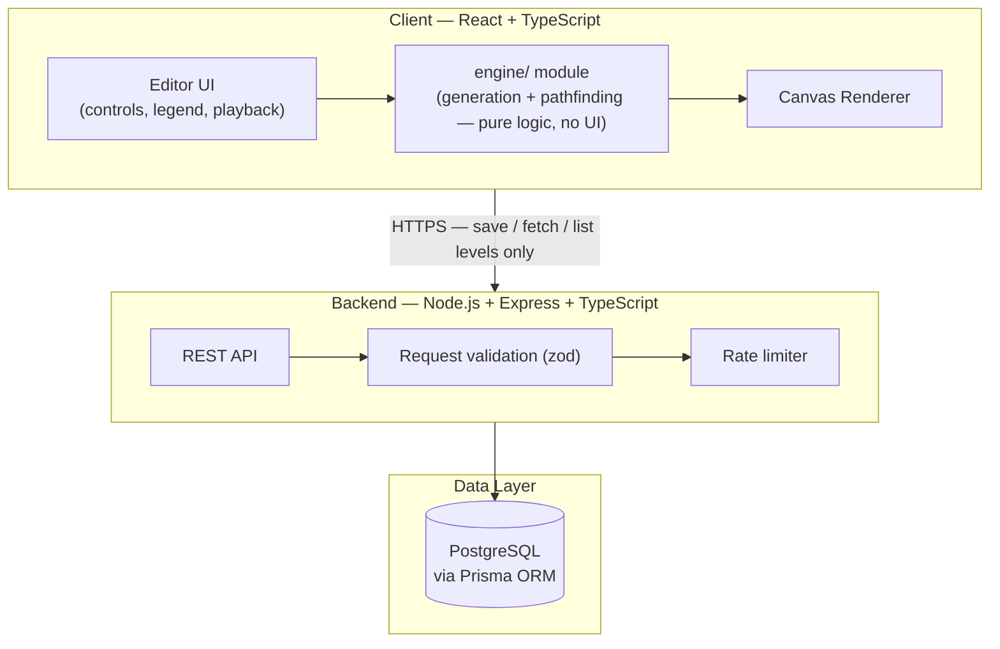
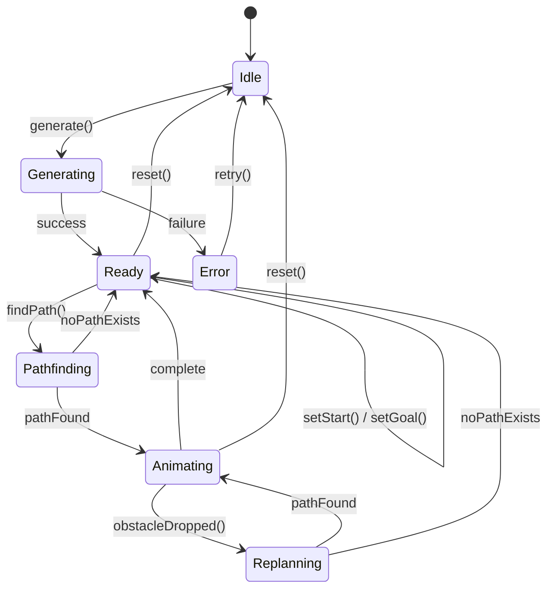
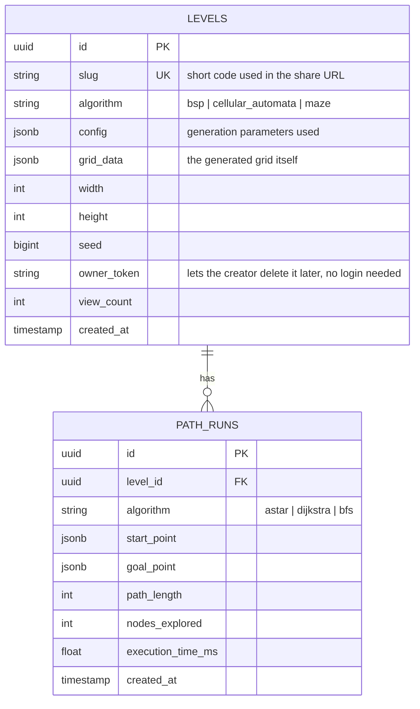
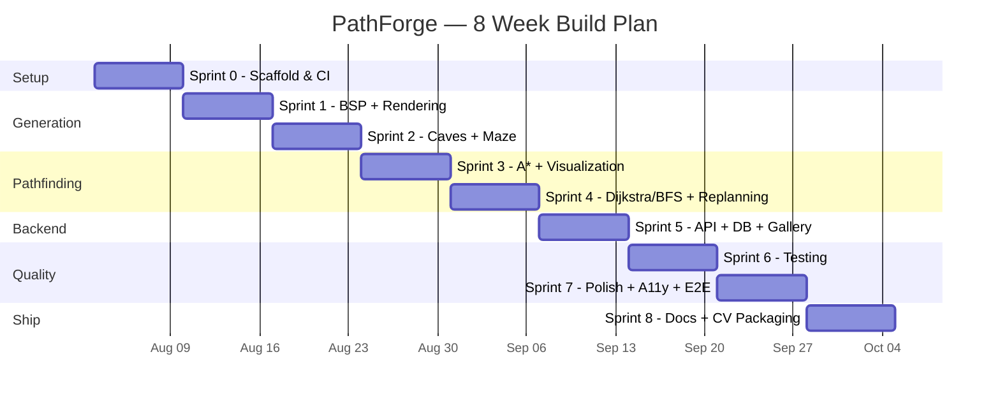
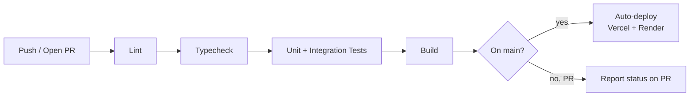

# PathForge
### A Procedural Dungeon Generation & Pathfinding AI Engine
**Full SDLC Blueprint — from zero to a portfolio-ready, deployed, tested product**

| | |
|---|---|
| **Document version** | 1.0 |
| **Prepared for** | Moaed — CV / portfolio project (not a course deliverable) |
| **Status** | Approved for build |
| **Target build window** | 8 weeks (flexible — see §6.3) |

> **What this document is:** a complete Software Development Life Cycle (SDLC) package for one project — requirements, architecture, database, API, algorithms, sprint plan, test strategy, deployment, and how to package it for recruiters. Follow it top to bottom, in order, the same way you'd work through any of your course material. Every section tells you *what* to do and *why* before it tells you *how*.

---

## Table of Contents

1. [Executive Summary](#1-executive-summary)
2. [Feasibility Study](#2-feasibility-study)
3. [Requirements Specification (SRS)](#3-requirements-specification-srs)
4. [System Architecture & Design](#4-system-architecture--design)
5. [Implementation Plan](#5-implementation-plan)
6. [Testing Strategy](#6-testing-strategy)
7. [Deployment & DevOps](#7-deployment--devops)
8. [Risk Management](#8-risk-management)
9. [Maintenance & Roadmap](#9-maintenance--roadmap)
10. [CV & Portfolio Packaging](#10-cv--portfolio-packaging)
11. [Appendix](#11-appendix)

---

## 1. Executive Summary

### 1.1 Problem Statement

Two separate problems, one project:

1. **Your problem:** your CV has one strong project (DeenComplete) and needs a second one that proves a *different* kind of skill — systems thinking and algorithms, not just "built a mobile app." Recruiters and game-studio hiring guides are explicit that a candidate's profile should make one clear specialization obvious fast, and that one finished, well-documented project beats several half-built ones.
2. **The industry gap this project demonstrates:** almost every student game-dev portfolio shows a finished (small, rough) *game*. Almost none show clearly-labeled, individually explained *systems* — which is specifically what studios say they're actually screening for in programmer applicants, gameplay or otherwise.

### 1.2 Solution Overview

**PathForge** is a browser-based tool that:
- Procedurally generates 2D dungeon/level layouts using **three different algorithms** (room-and-corridor, cave-like, and perfect maze)
- Runs and **visually animates** pathfinding AI (A\*, with Dijkstra and Breadth-First Search for comparison) across whatever it just generated
- Lets a virtual agent walk the found path and **replan live** when you drop obstacles in front of it
- Lets you **save and share** a generated level via a public link, with a small gallery of saved levels

No install. No engine to download. A recruiter clicks a link and watches your algorithms run in the browser within seconds.

### 1.3 Why This Specific Project (the evidence)

This isn't a random idea — every design decision below traces back to something concrete:

- Ubisoft's own current job listings run through gameplay, rendering, networking, physics, **and AI/tools/data-pipeline work** — plus they're actively hiring ML/MLOps roles, not only C++ gameplay programmers. This project's core is literally "AI navigating a generated world," which is the same category of problem.
- Every game-portfolio guide reviewed says the same thing: portfolios that name the specific systems a candidate built themselves ("procedural dungeon generation," "custom A\* pathfinding") get noticed; unexplained gameplay clips get scrolled past.
- General 2026 hiring data across all of software (not just games) shows one finished, tested, documented project consistently outperforms several unfinished ones — which is why this blueprint is scoped to **ship one thing completely** rather than sprawl.

### 1.4 Success Criteria

You'll know this project is "CV-ready" when all of the following are true:
- [ ] Live, public URL — works with zero setup for a stranger
- [ ] All three generation algorithms and all three pathfinding algorithms are implemented and demoable
- [ ] Automated tests exist and pass in CI (not just "it worked when I ran it")
- [ ] A recruiter with 30 seconds can understand what you built and that you built it alone
- [ ] You can explain, out loud, *why* you made every major design decision in this document

---

## 2. Feasibility Study

### 2.1 Technical Feasibility — **High**

Every piece of this uses well-documented, mainstream, free tools. Nothing here requires a game engine, GPU work, or C++.

| Concern | Verdict |
|---|---|
| Can this run entirely in a browser? | Yes — Canvas 2D API is more than enough for a grid-based game; no WebGL needed |
| Do the algorithms have known, provable correct implementations to check your work against? | Yes — A\*, Dijkstra, BFS, BSP, and cellular-automata cave generation are all textbook algorithms with decades of reference material |
| Is the backend/database piece necessary complexity, or scope creep? | Necessary — it's what turns this from "a script" into "a full-stack product," and it's intentionally kept small (§4.6–4.7) |

### 2.2 Skill Feasibility — mapped to what you already know

| You already have | This project needs | Gap |
|---|---|---|
| JavaScript/JSX from React Native (DeenComplete) | React + TypeScript (web) | Small — same mental model, TS adds type annotations you'll pick up in days |
| Strong Java (OOP, data structures) | The actual algorithm logic (grids, priority queues, recursion, graph traversal) | None — this maps directly from Java thinking, just different syntax |
| Some exposure to formal structures (SWE 302: FSMs) | The app's core interaction is modeled as a finite state machine (§4.5) | None — you'll recognize this immediately |
| — | Node.js/Express backend, PostgreSQL, Prisma ORM | New, but small surface area — this blueprint only needs 4 endpoints total |

You are not learning a new paradigm here. You're applying algorithms you can reason about in Java, in a language (TypeScript) that's a short hop from what you already write.

### 2.3 Time Feasibility

Scoped for **8 weeks at a sustainable pace** (a few focused hours, a few times a week) — not a crunch project. Section 6.3 gives you a week-by-week plan with a built-in buffer, and every sprint has a genuine "done" checkpoint so slipping a week never means the whole thing collapses. If you have less time, §9.2 tells you exactly what to cut without gutting the CV value.

### 2.4 Cost Feasibility — **$0**

Every tool and every hosting service in this blueprint has a free tier sufficient for a portfolio project (frontend hosting, backend hosting, and database are all covered in §7.3). No purchases required to complete or demo this project.


---

## 3. Requirements Specification (SRS)

### 3.1 Scope

**In scope (MVP — what "done" means):**
- Client-side generation (BSP rooms, cellular-automata caves, recursive-backtracker maze)
- Client-side pathfinding (A\*, Dijkstra, BFS) with step-by-step animated visualization
- Manual or random start/goal placement, dynamic obstacle-drop with live replanning
- Save/share a level via a generated link (backend + database)
- Public gallery of saved levels
- Automated test suite + CI/CD + live deployment

**Explicitly out of scope for MVP (stretch goals, §9.2):**
- User accounts / authentication (sharing is anonymous, ownership via a secret token — see §4.7)
- 3D rendering, real game engine (Unity/Unreal) integration
- Real-time multiplayer exploration
- Mobile app version (this is a web tool by design — see §1.2 rationale on "no install")

Explicitly writing down what's *out* of scope matters as much as what's in it — it's what stops this from sprawling into the "unfinished eight projects" trap the research warned about.

### 3.2 Actors / Stakeholders

| Actor | Description | Primary goal |
|---|---|---|
| **Visitor / Recruiter** | Someone landing on the shared link with zero context | Understand what was built, in under 30 seconds, without creating an account |
| **Level Creator** | You, using the editor | Generate, tune, test, and share levels |
| **Developer (you, wearing a different hat)** | Maintains the codebase | Clean, tested, documented code that's easy to extend |

### 3.3 Functional Requirements

Each requirement has an ID so you can reference it in commits, tests, and PRs (e.g., a commit message like `feat: implement FR-5 A* pathfinding`).

| ID | Requirement | Priority |
|---|---|---|
| FR-1 | User can choose a generation algorithm: BSP (rooms), Cellular Automata (caves), or Maze (recursive backtracker) | Must |
| FR-2 | User can configure generation parameters (grid width/height, seed, and an algorithm-specific parameter — e.g., room count for BSP, fill density for CA) | Must |
| FR-3 | System renders the generated grid on a canvas immediately after generation | Must |
| FR-4 | User can set a Start cell and a Goal cell, either by clicking or via a "randomize" button that picks two connected, walkable cells | Must |
| FR-5 | System computes a path using the selected pathfinding algorithm (A\*, Dijkstra, or BFS) | Must |
| FR-6 | System animates the pathfinding search step-by-step (showing the expanding frontier), then animates the final path | Must |
| FR-7 | User can run two algorithms side-by-side on the same grid to visually compare how many cells each one explores | Should |
| FR-8 | User can drop an obstacle on the grid while the agent is walking the path; the agent replans live and continues | Must |
| FR-9 | User can save the current level; system returns a short shareable URL | Must |
| FR-10 | Anyone with the shareable URL can view that exact level (same layout, same seed) with no login | Must |
| FR-11 | User can browse a paginated gallery of publicly saved levels, newest first | Should |
| FR-12 | User can export the current level as a JSON file | Could |
| FR-13 | User who created a level can delete it using the secret token they received at save time | Could |

*(Must/Should/Could = MoSCoW prioritization — Must = MVP-blocking, Should = do if time allows, Could = stretch)*

### 3.4 Non-Functional Requirements

| ID | Category | Requirement |
|---|---|---|
| NFR-1 | Performance | Generating a 100×100 grid completes in under 200ms on a mid-range laptop |
| NFR-2 | Performance | Pathfinding animation renders at ≥30fps during playback |
| NFR-3 | Usability | A first-time visitor can go from landing on the page to seeing a completed path in 3 clicks or fewer |
| NFR-4 | Compatibility | Fully functional on current Chrome, Firefox, Safari, and Edge; responsive down to a 768px-wide viewport |
| NFR-5 | Reliability | Frontend works fully offline for generation/pathfinding (only save/share needs the network) — this also protects the live demo from backend downtime |
| NFR-6 | Maintainability | ≥80% unit test coverage on the `engine/` folder specifically (the generation + pathfinding logic — the code recruiters will actually judge you on) |
| NFR-7 | Security | All API input validated server-side (grid dimensions bounded, config schema-checked); save endpoint rate-limited to prevent abuse of the free-tier database |
| NFR-8 | Accessibility | All controls keyboard-operable; sufficient color contrast (WCAG AA) on UI chrome; ARIA labels on interactive controls |

### 3.5 Key Use Cases

**UC-1: Generate a level**
- **Actor:** Level Creator
- **Trigger:** User selects an algorithm and clicks "Generate"
- **Main flow:** System validates parameters → runs the selected generator → renders the grid → enables Start/Goal placement
- **Alternate flow:** Invalid parameters (e.g., grid too large) → inline validation message, generation blocked until fixed

**UC-2: Find and animate a path**
- **Actor:** Level Creator
- **Precondition:** A level has been generated, Start and Goal are set
- **Main flow:** User clicks "Find Path" → system runs the selected algorithm → animates explored cells in order → animates the final path → agent walks it
- **Alternate flow:** No path exists (start and goal are in disconnected regions) → system shows the fully-explored search space and a clear "no path exists" message instead of failing silently

**UC-3: Obstacle drop + replan**
- **Actor:** Level Creator
- **Precondition:** Agent is currently animating along a path
- **Main flow:** User clicks a cell on the remaining path → cell becomes a wall → agent's current position becomes a new Start → system re-runs pathfinding from there to the original Goal → agent continues

**UC-4: Save and share**
- **Actor:** Level Creator → Visitor
- **Main flow:** Creator clicks "Save" → system persists the level + returns `{ url, ownerToken }` → Creator shares the URL → Visitor opens it → system fetches and renders the exact same level, read-only by default

### 3.6 User Stories (with acceptance criteria)

```
US-1
As a visitor with no context,
I want to see a generated dungeon and a path animate automatically on page load,
So that I understand what this project does before reading anything.
  Acceptance criteria:
  - Page loads with a pre-generated example level, not a blank state
  - Pathfinding animation autoplays once, then hands control to the user

US-2
As a level creator,
I want to compare A*, Dijkstra, and BFS on the same grid,
So that I can see (not just read) why A* explores fewer cells.
  Acceptance criteria:
  - "Compare" mode runs all three and shows explored-cell counts side-by-side
  - Each algorithm's explored region is rendered in a distinct color

US-3
As a level creator,
I want to share a specific level with someone else,
So that they see exactly what I built, not a random new one.
  Acceptance criteria:
  - Shared URL reproduces the identical grid (same seed + same algorithm)
  - No login required to view a shared level
```

---

## 4. System Architecture & Design

### 4.1 High-Level Architecture

The generation and pathfinding logic runs **entirely in the browser** — no network round-trip needed to see it work. The backend's only job is saving/loading/listing levels. This split matters: it means the demo never breaks just because a free-tier server is asleep (see Risk R-2, §8).



**Why this split:** the `engine/` module (algorithms) is written as plain TypeScript with zero UI or network dependencies. That's a deliberate architecture decision, not an accident — it means the exact same generation and pathfinding code can be unit-tested in total isolation (§6) and, if you ever want to, reused server-side too. Recruiters who read code notice when core logic isn't tangled up with UI code.

### 4.2 Tech Stack & Justification

| Layer | Choice | Why this and not something else |
|---|---|---|
| Frontend framework | React + TypeScript (Vite) | You already think in React from DeenComplete; TypeScript catches whole categories of bugs before you run the code — genuinely useful when debugging grid/graph logic |
| Rendering | HTML5 Canvas 2D API (no game-engine library) | A grid of cells is exactly what Canvas is for; skipping a heavy library shows you can render close to the metal, which reads as more impressive than "a library did it for me" |
| State management | React Context + `useReducer` | The editor has one central piece of state (current grid, algorithm, playback status) — a full state library (Redux) would be over-engineering for this scope |
| Backend | Node.js + Express + TypeScript | Same language as the frontend end-to-end (one language, two runtimes) — minimizes context-switching while you're also mid-exams on other subjects |
| ORM / Database | Prisma + PostgreSQL | Prisma auto-generates types from your schema (fewer bugs), and PostgreSQL is the single most commonly *required* database skill in job postings — more transferable than SQLite |
| Validation | zod | Schema validation that shares types between "what the API expects" and "what TypeScript thinks the shape is" — one definition, not two |
| Testing | Vitest (unit) + Supertest (API) + Playwright (E2E) | Vitest is Vite-native (fast, zero extra config); the other two are the current standard choice for their layer |
| CI/CD | GitHub Actions | Free, and it's what you'll list on a resume as "CI/CD experience" — worth using the real thing |
| Hosting | Vercel (frontend) + Render or Railway (backend) + Neon or Supabase (Postgres) | All have free tiers sufficient for a demo; all deploy straight from a GitHub push |

### 4.3 Module Breakdown

```
src/
├── engine/                  ← the "systems" — pure logic, framework-agnostic, heavily tested
│   ├── generators/
│   │   ├── bspGenerator.ts
│   │   ├── cellularAutomataGenerator.ts
│   │   ├── mazeGenerator.ts
│   │   └── Generator.ts     ← shared interface all three implement
│   ├── pathfinding/
│   │   ├── aStar.ts
│   │   ├── dijkstra.ts
│   │   ├── bfs.ts
│   │   └── Pathfinder.ts    ← shared interface all three implement
│   ├── agent/
│   │   └── agentStateMachine.ts   ← the FSM in §4.5
│   └── grid/
│       ├── Grid.ts          ← core grid data structure
│       └── seededRandom.ts  ← deterministic RNG so a seed always reproduces the same level
│
├── components/               ← UI only, talks to engine/ but contains no algorithm logic
│   ├── CanvasRenderer.tsx
│   ├── ControlPanel.tsx
│   ├── PlaybackControls.tsx
│   └── Gallery.tsx
│
├── api/                       ← thin client for talking to the backend
│   └── levelsClient.ts
│
└── App.tsx

server/
├── src/
│   ├── routes/levels.ts
│   ├── validation/levelSchemas.ts   ← zod schemas
│   ├── middleware/rateLimiter.ts
│   └── prisma/schema.prisma
```

The line between `engine/` and `components/` is the single most important architectural decision in this project — keep it strict. If you ever find yourself writing grid or pathfinding logic inside a `.tsx` file, stop and move it into `engine/`.

### 4.4 Core Algorithms

Each one below follows the same pattern: **plain-language idea first, then the steps, then pseudocode.** Don't write real code from this directly — read it, make sure you could explain the idea to someone else without notes, *then* implement it.

#### 4.4.1 Generator: BSP (rooms & corridors)

**The idea:** imagine slicing a cake with straight cuts, again and again, until every piece is small enough. Then hollow out a room somewhere inside each final piece, and build a hallway between every pair of neighboring pieces.

**Steps:**
1. Start with one region covering the whole grid.
2. If the region is bigger than your minimum room size, split it in half — vertically or horizontally, whichever side is longer — at a random point.
3. Repeat step 2 on each half, until regions are too small to split further or you hit a max depth.
4. Inside each final (leaf) region, carve a room slightly smaller than the region itself, at a random offset.
5. Walk back up the split tree; between every pair of sibling regions, connect their rooms with an L-shaped corridor.

```
function generateBSP(width, height, minRoomSize, maxDepth, seed):
    rng = new SeededRandom(seed)
    root = new BSPNode(0, 0, width, height)
    splitRecursively(root, depth=0, maxDepth, minRoomSize, rng)
    leaves = collectLeafNodes(root)
    for each leaf in leaves:
        leaf.room = carveRoomInside(leaf.bounds, rng)
    connectSiblingRooms(root)   // bottom-up: corridor between each sibling pair
    return gridFromRooms(leaves)

function splitRecursively(node, depth, maxDepth, minRoomSize, rng):
    if depth >= maxDepth or node.width < 2*minRoomSize or node.height < 2*minRoomSize:
        return   // this node becomes a leaf — stop splitting
    splitVertically = node.width > node.height
    splitPoint = rng.between(minRoomSize, node.splitDimension - minRoomSize)
    node.left, node.right = split(node, splitVertically, splitPoint)
    splitRecursively(node.left,  depth + 1, maxDepth, minRoomSize, rng)
    splitRecursively(node.right, depth + 1, maxDepth, minRoomSize, rng)
```

#### 4.4.2 Generator: Cellular Automata (caves)

**The idea:** the same rule behind Conway's Game of Life. Start with random static (like an old TV screen — each cell is randomly a wall or floor). Then repeatedly apply one rule: *"if most of my neighbors are walls, I become a wall too; otherwise I become floor."* Do that a handful of times and the random noise settles into smooth, organic-looking caves.

**Steps:**
1. Fill the grid randomly: each cell is a wall with some probability (e.g. 45%), floor otherwise.
2. For a fixed number of passes: for every cell, count how many of its 8 neighbors are walls. If 5 or more are walls, the cell becomes a wall next pass; otherwise it becomes floor.
3. After smoothing, flood-fill to find all connected floor regions, and keep only the largest one (this guarantees the whole cave is reachable — no isolated pockets).

```
function generateCaves(width, height, fillProbability, smoothingPasses, seed):
    rng = new SeededRandom(seed)
    grid = randomFill(width, height, fillProbability, rng)
    repeat smoothingPasses times:
        grid = applySmoothingPass(grid)   // per cell: wallNeighborCount >= 5 -> WALL, else FLOOR
    grid = keepLargestConnectedRegion(grid)   // flood fill; drop isolated pockets
    return grid
```

#### 4.4.3 Generator: Maze (Recursive Backtracker)

**The idea:** like walking through a hedge maze where you always carve a brand-new path forward, never cross a path you've already made, and backtrack when you hit a dead end. This guarantees a "perfect maze" — every cell reachable, exactly one route between any two points, no loops.

```
function generateMaze(width, height, seed):
    rng = new SeededRandom(seed)
    grid = allWalls(width, height)
    stack = [ randomCell(rng) ]
    mark(stack.top, VISITED)
    while stack is not empty:
        current = stack.top
        neighbors = unvisitedNeighborsTwoCellsAway(current, grid)
        if neighbors is empty:
            stack.pop()                              // dead end — backtrack
        else:
            next = rng.choose(neighbors)
            knockDownWallBetween(current, next, grid)
            mark(next, VISITED)
            stack.push(next)
    return grid
```

#### 4.4.4 Pathfinder: A\*

**The idea:** a smart hiker who tracks two numbers for every spot they could step to next — *how far I've already walked to get here* (like Dijkstra) *and my best guess of how much further to the destination* (a straight-line estimate). Adding those together and always exploring the most promising total first means A\* reaches the goal without wastefully exploring in every direction equally.

```
function aStar(grid, start, goal):
    openSet = new MinHeap(orderBy = fScore)
    openSet.push(start, priority = 0)
    cameFrom = {}
    gScore = { start: 0 }
    fScore = { start: heuristic(start, goal) }
    visitedOrder = []                          // recorded purely for animation replay

    while openSet is not empty:
        current = openSet.popLowest()
        visitedOrder.append(current)
        if current == goal:
            return { path: reconstructPath(cameFrom, current), visitedOrder, found: true }
        for neighbor in walkableNeighbors(current, grid):
            tentativeG = gScore[current] + cost(current, neighbor)
            if tentativeG < gScore.get(neighbor, Infinity):
                cameFrom[neighbor] = current
                gScore[neighbor] = tentativeG
                fScore[neighbor] = tentativeG + heuristic(neighbor, goal)
                openSet.pushOrUpdate(neighbor, priority = fScore[neighbor])
    return { path: [], visitedOrder, found: false }

function heuristic(a, b):
    return abs(a.x - b.x) + abs(a.y - b.y)     // Manhattan distance — admissible for 4-directional movement
```

#### 4.4.5 Pathfinder: Dijkstra & BFS (for the comparison mode, FR-7)

- **Dijkstra** = A\* with the "guess how much further" part always set to zero. It floods outward evenly in every direction, closest-explored-first — guaranteed shortest path, but explores far more cells than A\* because it has no sense of *direction* toward the goal.
- **BFS** = Dijkstra again, but only valid when every step costs exactly the same (true here — one grid cell always costs 1). Expands in uniform "rings," like ripples in a pond.

Implement both by reusing the *same* open-set/relaxation structure as `aStar.ts`, just swapping the priority rule — this is a good moment to notice (and be able to explain in an interview) that all three algorithms are really one algorithm with a different heuristic function.

### 4.5 Application State Machine

This is the same idea as the FSMs from SWE 302, applied to the app's actual behavior rather than an abstract example. Modeling this explicitly *before* writing UI code means you can't accidentally build an impossible state (like "animating" and "generating" at the same time) — the diagram itself becomes the spec.



| State | Meaning | Valid actions from here |
|---|---|---|
| `Idle` | No level generated yet | `generate()` |
| `Generating` | Algorithm is running | *(no user input accepted — this should be near-instant per NFR-1)* |
| `Ready` | Grid exists, no active pathfinding | `setStart()`, `setGoal()`, `findPath()`, `reset()` |
| `Pathfinding` | Search algorithm is computing | *(no input — brief, computed synchronously)* |
| `Animating` | Playing back the explored-cells + path animation | `obstacleDropped()`, pause/play, `reset()` |
| `Replanning` | Recomputing path after an obstacle | *(no input — brief)* |
| `Error` | Generation failed (e.g., impossible parameters) | `retry()` |


### 4.6 Database Design

Deliberately small — two tables. The temptation on a portfolio project is to over-build the backend; resist it (see Risk R-5, §8.1). A clean, small, correctly-normalized schema reads as more competent than a bloated one.



**Design notes worth being able to explain in an interview:**
- `slug` is a short, human-shareable code (e.g. `k3f9x2`) — separate from the `id` (a UUID) so URLs stay clean.
- `owner_token` is a random secret returned once, at creation, and never displayed again. This gives "only the creator can delete it" behavior without building a full authentication system — a deliberate scope trade-off (documented, not accidental).
- `PATH_RUNS` is optional data (FR-7's comparison mode) kept in its own table rather than crammed into `LEVELS`, so a level can accumulate multiple recorded runs without repeating level data — basic normalization.

Prisma schema (this *is* real code — copy it directly into `server/src/prisma/schema.prisma`):

```prisma
model Level {
  id          String     @id @default(uuid())
  slug        String     @unique
  algorithm   String
  config      Json
  gridData    Json       @map("grid_data")
  width       Int
  height      Int
  seed        BigInt
  ownerToken  String     @map("owner_token")
  viewCount   Int        @default(0) @map("view_count")
  createdAt   DateTime   @default(now()) @map("created_at")
  pathRuns    PathRun[]

  @@map("levels")
}

model PathRun {
  id               String   @id @default(uuid())
  levelId          String   @map("level_id")
  level            Level    @relation(fields: [levelId], references: [id])
  algorithm        String
  startPoint       Json     @map("start_point")
  goalPoint        Json     @map("goal_point")
  pathLength       Int      @map("path_length")
  nodesExplored    Int      @map("nodes_explored")
  executionTimeMs  Float    @map("execution_time_ms")
  createdAt        DateTime @default(now()) @map("created_at")

  @@map("path_runs")
}
```

### 4.7 API Design

Four endpoints. That's the whole backend surface.

| Method | Endpoint | Purpose | Auth |
|---|---|---|---|
| `POST` | `/api/levels` | Save a generated level | None (public) |
| `GET` | `/api/levels/:slug` | Fetch one level by its share code | None |
| `GET` | `/api/levels?page=1&limit=20` | Paginated gallery, newest first | None |
| `DELETE` | `/api/levels/:slug` | Delete a level | Requires matching `ownerToken` in request body |

**Example — `POST /api/levels`**

Request:
```json
{
  "algorithm": "bsp",
  "config": { "minRoomSize": 4, "maxDepth": 5 },
  "gridData": "...",
  "width": 60,
  "height": 40,
  "seed": 482913
}
```

Response `201 Created`:
```json
{
  "slug": "k3f9x2",
  "ownerToken": "a1b2c3d4-...-do-not-lose-this",
  "shareUrl": "https://pathforge.app/level/k3f9x2"
}
```

Every request body is validated against a `zod` schema before it touches the database (NFR-7) — reject bad input at the door rather than trusting the client. Grid dimensions are bounded server-side (e.g., max 200×200) regardless of what the frontend allows, since the frontend is not a trust boundary.

### 4.8 Key Screens (wireframe description)

There's no separate design tool needed here — describe each screen in words, precisely enough that the layout is unambiguous when you sit down to build it.

**Main Editor (the only screen most visitors will ever see):**
```
┌─────────────────────────────────────────────────────────┐
│  PathForge                                    [Gallery]  │
├───────────────┬─────────────────────────────────────────┤
│ Algorithm:     │                                          │
│ ( ) BSP        │                                          │
│ ( ) Caves      │                                          │
│ ( ) Maze       │              CANVAS                      │
│                │        (generated grid renders here)     │
│ Width  [___]   │                                          │
│ Height [___]   │                                          │
│ Seed   [___]   │                                          │
│                │                                          │
│ [ Generate ]   │                                          │
│                │                                          │
│ Pathfinder:    │                                          │
│ ( ) A*         │                                          │
│ ( ) Dijkstra   │  ┌────────────────────────────────────┐  │
│ ( ) BFS        │  │ ▶ Play  ⏸ Pause  Speed: [====|--]  │  │
│ [ ] Compare    │  │ Explored: 142 cells  Path: 37 steps │  │
│                │  └────────────────────────────────────┘  │
│ [ Find Path ]  │                                          │
│ [ Save & Share]│                                          │
└───────────────┴─────────────────────────────────────────┘
```

**Gallery:** a responsive grid of small canvas thumbnails (each a static render of a saved level), algorithm badge, view count, "Open" link — intentionally simple, this is a secondary screen.


---

## 5. Implementation Plan

### 5.1 Coding Standards

- **Naming:** `PascalCase` for components and classes, `camelCase` for functions and variables, one component per file, file name matches export name.
- **Linting/formatting:** ESLint + Prettier, run on every commit via a pre-commit hook (`husky` + `lint-staged`) so style issues never even reach a PR.
- **Comments:** every exported function in `engine/` gets a short TSDoc comment explaining *what it returns and why*, not restating the code. Inline comments only where the "why" isn't obvious from the code itself.
- **Commit messages:** [Conventional Commits](https://www.conventionalcommits.org) style, referencing requirement IDs where relevant — e.g. `feat(engine): implement A* pathfinder (FR-5)`, `test(engine): add BSP determinism test (NFR-6)`. This gives you a commit history that reads like a changelog, which is exactly what a reviewer skimming your GitHub actually sees first.

### 5.2 Git Workflow

**GitHub Flow** (simpler than Git Flow — appropriate for a solo project):
- `main` is always deployable — every commit on `main` is something you'd be comfortable showing a recruiter right now.
- One branch per feature, named after the requirement it implements: `feature/fr-1-bsp-generator`, `feature/fr-5-astar`, `fix/...`.
- Open a Pull Request even solo. Self-review it before merging — read your own diff as if someone else wrote it. This is a genuine habit worth building now, and it means your GitHub shows real PR history, not just direct commits to `main`.
- Squash-merge each PR so `main`'s history stays one clean commit per feature.

### 5.3 Sprint Plan

Eight weekly sprints. Each has one clear goal and a concrete Definition of Done — if a sprint's DoD isn't met, that's fine, it just means it continues into the buffer rather than silently expanding scope on the next sprint too.



*(Start date above is a placeholder — slide the whole plan to whenever your exams actually clear. The relative order and durations are what matter.)*

| Sprint | Goal | Requirement IDs closed | Definition of Done |
|---|---|---|---|
| **0 — Setup** | Scaffold + working pipeline before writing a single algorithm | — | Empty app is live at a public URL; CI runs lint+build on every push |
| **1 — BSP** | First generator, first render | FR-1 (partial), FR-3 | Selecting BSP and clicking Generate renders a valid room layout |
| **2 — Caves + Maze** | Remaining two generators, live params | FR-1 (full), FR-2 | All 3 algorithms generate correctly; parameters visibly change output |
| **3 — A\*** | First pathfinder, animated | FR-4, FR-5 (partial), FR-6 | Start/Goal placement works; A\* animates search + final path |
| **4 — Dijkstra/BFS + Replanning** | Remaining pathfinders, obstacle handling | FR-5 (full), FR-7, FR-8 | Compare mode works; dropping an obstacle triggers a visible replan |
| **5 — Backend** | Persistence layer | FR-9, FR-10, FR-11 | A saved level's link reopens the identical layout in a new browser |
| **6 — Testing** | Prove it's correct, not just "it worked once" | NFR-6 | ≥80% coverage on `engine/`; full suite green in CI |
| **7 — Polish** | Make it feel finished | NFR-3, NFR-4, NFR-8 | Responsive + keyboard-accessible; Playwright E2E suite passes in CI |
| **8 — Ship** | Package it for a recruiter, not just for you | — | Every checkbox in §1.4 Success Criteria is checked |

### 5.4 Definition of Done (applies to every feature, every sprint)

- [ ] Passes lint + typecheck with zero errors
- [ ] Has at least one unit test if it touches `engine/`
- [ ] Opened as a PR and self-reviewed before merging to `main`
- [ ] Zero console errors/warnings in the browser
- [ ] Manually smoke-tested on the live deployed URL, not just `localhost`
- [ ] PR description references the FR/NFR/UC ID(s) it closes


---

## 6. Testing Strategy

### 6.1 Test Levels

| Level | Tool | What it covers | Runs |
|---|---|---|---|
| Unit | Vitest | `engine/` — generators, pathfinders, state machine — pure logic, no UI, no network | On every save (watch mode) + every CI run |
| Integration | Vitest + Supertest | API routes — request validation, database interaction, error responses | Every CI run |
| End-to-end (E2E) | Playwright | Full user flows through the real UI in a real browser | Every CI run on `main`, plus before every deploy |
| Manual / UAT | Checklist (below) | Things automated tests are bad at — "does this feel right," cross-browser spot checks | Once per sprint, and before Sprint 8 ship |

### 6.2 Key Test Cases

**Engine unit tests — these are the tests recruiters would actually care about if they opened your test file:**

| Test | Why it matters |
|---|---|
| `generateBSP` with a fixed seed produces byte-identical output across two runs | Proves determinism — same seed must always mean same level, which FR-10 (shareable links) depends on |
| Every room produced by `generateBSP` is fully enclosed by walls | Correctness of the core algorithm, not just "it ran without crashing" |
| Every sibling room pair has a connecting corridor (no isolated rooms) | The actual point of BSP generation — an unreachable room is a bug, not a feature |
| `generateCaves` — the largest connected region contains 100% of the "floor" cells after `keepLargestConnectedRegion` | Guarantees the cave the player sees is fully navigable — no invisible unreachable pockets |
| `generateMaze` — exactly one path exists between any two reachable cells | This is the literal definition of a "perfect maze" — a direct, checkable correctness property |
| `aStar` on a hand-solved 5×5 grid returns the known-correct shortest path | Ground-truth correctness check, not just "did it return something" |
| `aStar` returns `found: false` (not a crash, not an infinite loop) when start and goal are in disconnected regions | This is the single most common bug class in student pathfinding implementations |
| `aStar` explores fewer-or-equal nodes than `dijkstra` on the same grid, across 20 randomized grids | A *property-based* test — proves you understand **why** A\* is better, not just that it runs |
| `start === goal` returns an empty/zero-length path immediately, no search performed | Edge case that's easy to forget and easy to get subtly wrong |

**API integration tests:**

| Test | Expected result |
|---|---|
| `POST /api/levels` with a valid body | `201`, response includes `slug` and `ownerToken` |
| `POST /api/levels` with grid dimensions above the server-side cap | `400` — proves NFR-7 (server never trusts client-side limits alone) |
| `GET /api/levels/:slug` for a slug that doesn't exist | `404`, not a `500` crash |
| `DELETE /api/levels/:slug` with an incorrect `ownerToken` | `403` |
| 20 rapid `POST /api/levels` calls from the same IP within a short window | The rate limiter returns `429` after the configured threshold |

**E2E tests (Playwright — one per use case from §3.5):**

| Test | Covers |
|---|---|
| Select an algorithm, click Generate, canvas is non-empty | UC-1 |
| Set Start/Goal, click Find Path, animation completes and shows a found path | UC-2 |
| Drop an obstacle mid-animation, agent visibly reroutes and still reaches the goal | UC-3 |
| Save a level, open the returned URL in a fresh browser context, identical grid renders | UC-4 |

### 6.3 Coverage Targets

- `engine/` (generators + pathfinding + state machine): **≥80%** line coverage — this is the number worth putting in your README, because it's the code your CV claims are actually about.
- `api/` routes: all four endpoints have at least a happy-path and one failure-path test.
- Overall project coverage: no hard target — chasing a high number on UI glue code wastes time better spent elsewhere. Coverage is a tool for confidence, not a score to maximize everywhere equally.


---

## 7. Deployment & DevOps

### 7.1 Environments

| Environment | Purpose | Where |
|---|---|---|
| Local | Day-to-day development | Your machine, `npm run dev` |
| CI | Automated checks on every push/PR | GitHub Actions (ephemeral) |
| Production | The live URL you actually share | Vercel (frontend) + Render/Railway (backend) + Neon/Supabase (database) |

A small project like this doesn't need a separate "staging" environment — `main` being always-deployable (§5.2) is what keeps production safe without one.

### 7.2 CI/CD Pipeline



Real, working GitHub Actions config — this goes in `.github/workflows/ci.yml`:

```yaml
name: CI

on:
  pull_request:
    branches: [main]
  push:
    branches: [main]

jobs:
  test-and-build:
    runs-on: ubuntu-latest
    steps:
      - uses: actions/checkout@v4
      - uses: actions/setup-node@v4
        with:
          node-version: 20
          cache: 'npm'
      - run: npm ci
      - run: npm run lint
      - run: npm run typecheck
      - run: npm run test -- --coverage
      - run: npm run build
```

Vercel and Render both deploy automatically on a push to `main` through their own native GitHub integration — you don't need a separate `deploy` job in this file. What you *should* do is turn on a branch protection rule on `main` (repo Settings → Branches) requiring this CI job to pass before a PR can merge. That single setting is what makes "main is always deployable" a guarantee instead of a hope.

### 7.3 Hosting & Infrastructure

| Component | Suggested service | Notes |
|---|---|---|
| Frontend | Vercel | Auto-deploys on push, generous free tier for a single-page app |
| Backend API | Render or Railway | Free tier instances can "sleep" after inactivity, causing a ~30–50s cold start on the first request — mitigated by Risk R-2 (§8) |
| Database | Neon or Supabase | Free-tier managed PostgreSQL, no server to maintain yourself |
| Domain | Default subdomain (e.g. `pathforge.vercel.app`) is completely fine for a portfolio piece | A custom domain is a nice-to-have, never a blocker |

Free-tier terms shift over time — confirm current limits when you actually sign up for each service.

### 7.4 Versioning & Releases

- [Semantic Versioning](https://semver.org): `v0.1.0` tagged at the end of Sprint 1 (first working generator), incrementing minor versions through the build, `v1.0.0` tagged at Sprint 8 ship.
- Keep a short `CHANGELOG.md`, updated at the end of each sprint — three or four bullet points, not a novel. This becomes genuinely useful later, and GitHub's own "Releases" page picks it up automatically from your tags.


---

## 8. Risk Management

| ID | Risk | Likelihood | Impact | Mitigation |
|---|---|---|---|---|
| R-1 | Scope creep — the project quietly grows past what one person can finish | Medium | High | Strict MVP list (§3.1), MoSCoW priorities on every FR, a weekly Definition of Done that's either met or explicitly deferred — never silently expanded |
| R-2 | Free-tier backend "cold starts" hurt the live demo experience for a recruiter | High | Medium | Core generation/pathfinding demo works **fully offline in the browser** (§4.1) — only save/share touches the backend, so the most important part of the demo is never at the mercy of a sleeping server |
| R-3 | Time conflicts with ongoing coursework and exams | High | High | Plan has a full buffer sprint (Sprint 8) and every earlier sprint's DoD is independently "CV-ready" — slipping the schedule never means having nothing to show |
| R-4 | Subtle correctness bugs in generation/pathfinding algorithms | Medium | Medium | Test-first discipline specifically on `engine/` (§6.2), including property-based and edge-case tests, not just happy-path |
| R-5 | Backend/database work expands to consume time that should go to the actual "systems" showcase | Medium | Medium | Backend scope is fixed at 4 endpoints and 2 tables (§4.6–4.7) before Sprint 5 starts — timeboxed, not open-ended |
| R-6 | Losing motivation partway through a solo 8-week build | Medium | High | Every sprint ships something *visibly different* (§5.3) — you always have something better to show at the end of a sprint than at the start, which is what actually sustains momentum on solo projects |

---

## 9. Maintenance & Roadmap

### 9.1 Post-Launch

Nothing heavy needed for a portfolio project — but doing this much is what separates "I built a thing once" from "I maintain a thing":
- Enable Dependabot (GitHub Settings → Security) so dependency updates arrive as PRs automatically instead of quietly going stale.
- Glance at Vercel/Render logs occasionally for unexpected errors.
- If someone opens a GitHub issue on it, respond — even a small public interaction thread reads well to anyone browsing your repo.

### 9.2 If you're short on time — what to cut without losing CV value

Cut in this order; each step still leaves a complete, demoable, full-stack story:
1. Drop FR-11/12/13 (gallery, export, delete) — save + direct share link is enough.
2. Drop FR-7 (compare mode) — three working pathfinders is already the impressive part; the side-by-side is a nice-to-have.
3. If truly squeezed, drop the backend entirely (FR-9/10/11) and ship it as a pure client-side tool. You lose the "full-stack" claim but keep every algorithm and the entire systems showcase intact — still a strong, complete CV project on its own.

### 9.3 If you want to go further (Phase 2 ideas, after v1.0 ships)

- **Wave Function Collapse** as a fourth generation algorithm — a more advanced, currently well-regarded procedural generation technique (constraint-based tile generation) that would meaningfully raise the ceiling on this project if you want a true standout piece
- Weighted terrain (some cells cost more to cross than others) — this is the scenario where Dijkstra's advantage over BFS actually becomes visible, a nice showcase addition
- Optional accounts, so a creator can manage a personal collection of saved levels
- A lightweight "race the AI" mode — human clicks a path manually, agent solves it with A\* simultaneously, compare times


---

## 10. CV & Portfolio Packaging

This is the section that actually gets you hired — the code proves you can build it, this section proves you can *communicate* it. Don't skip it or rush it in the last hour of Sprint 8.

### 10.1 README Template

Copy this into `README.md` at the repo root and fill in the brackets. The order is deliberate: link and GIF first, because that's genuinely all some reviewers will look at.

```markdown
# PathForge

**[Live Demo →](your-url-here)**

A browser-based procedural dungeon generator and pathfinding visualizer — three
generation algorithms, three pathfinding algorithms, live obstacle replanning,
and shareable levels. No install required.


## What I built
- **Procedural generation engine** — BSP (rooms & corridors), Cellular Automata
  (caves), and Recursive Backtracker (perfect mazes), implemented from scratch
- **Pathfinding AI** — A*, Dijkstra, and BFS with step-by-step animated search
  visualization and a side-by-side comparison mode
- **Live replanning** — drop an obstacle mid-path and watch the agent recompute
  in real time
- **Full-stack persistence** — save and share any generated level via a public
  link (Node.js, Express, PostgreSQL)
- **80%+ test coverage** on the core algorithm engine; CI/CD via GitHub Actions

## Architecture
[embed or link the architecture diagram from §4.1]

## Stack
React · TypeScript · Node.js · Express · PostgreSQL · Prisma · Vitest · Playwright

## Running locally
\`\`\`bash
git clone [your-repo-url]
cd pathforge
npm install
npm run dev
\`\`\`

## What I'd build next
[2–3 honest, specific next steps — pull straight from §9.3]
```

### 10.2 Resume Bullets

Pick one or two, don't use all three — a resume rewards precision, not volume:

> Built PathForge, a full-stack procedural level generator and pathfinding visualizer (React, TypeScript, Node.js, PostgreSQL); implemented 3 procedural generation algorithms and 3 pathfinding algorithms (A\*, Dijkstra, BFS) with real-time obstacle replanning.

> Designed and executed a complete SDLC for a solo project — requirements specification, system architecture, 8-week sprint plan — achieving 80%+ automated test coverage on core algorithm logic, deployed with CI/CD via GitHub Actions.

> Implemented A\* pathfinding with live replanning and three procedural dungeon-generation algorithms in TypeScript; architected and deployed the full stack independently, including database design and a REST API.

### 10.3 Interview Talking Points

Be ready to explain each of these out loud, unscripted — this is what separates "I copied a tutorial" from "I built this":

- **Complexity:** why A\* explores fewer nodes than Dijkstra on the same grid, in your own words, with the heuristic as the reason
- **Design decision:** why `engine/` is completely separate from your UI components, and what that bought you (testability, and you can point to the actual test file)
- **Trade-off you made on purpose:** the `ownerToken` approach instead of full authentication — be ready to say *why* that was the right call for this project's scope, not just that it was easier
- **Algorithm intuition:** why BSP produces structured rooms while cellular automata produces organic caves — the underlying reason, not just "they're different algorithms"
- **Growth:** what you'd do differently now, and what Phase 2 (§9.3) would actually add — shows you can evaluate your own work critically, which reads better than pretending it's flawless

### 10.4 Demo GIF/Video Checklist

- Keep it under 45 seconds — this is for a README and a LinkedIn post, not a full walkthrough
- Sequence: auto-generated example on load → switch algorithm live → run pathfinding animation → drop an obstacle and show the replan → save and open the share link
- Free tools: **ScreenToGif** (Windows, lightweight, exactly for this) for the README GIF; OBS Studio if you also want a longer narrated video for LinkedIn
- Caption it when you post it — one or two sentences on what it is and what you learned, not just the clip on its own

### 10.5 Where This Goes on Your CV

List it alongside DeenComplete, not instead of it — the pairing is the actual point. DeenComplete shows you can ship a polished, real-world mobile product end-to-end for real users. PathForge shows you can design and reason about algorithms and systems from scratch. Two different capabilities, two different proof points — that range is exactly what was missing before this project existed.


---

## 11. Appendix

### 11.1 Glossary

| Term | Plain-language meaning |
|---|---|
| **FSM (Finite State Machine)** | A system that's always in exactly one of a fixed set of "states," with clear rules for what causes it to switch states — the same idea from SWE 302, applied to real app behavior in §4.5 |
| **Heuristic** | An educated guess used to make a search faster — in A\*, specifically an estimate of remaining distance to the goal |
| **Admissible heuristic** | A heuristic that never *overestimates* the true remaining distance — this is exactly what guarantees A\* still finds the truly shortest path, not just a fast-but-wrong one |
| **BSP (Binary Space Partitioning)** | Recursively splitting a space into two halves — used here to lay out rooms (§4.4.1) |
| **Flood fill** | An algorithm that starts at one cell and spreads outward to every connected neighbor — used here to find connected regions of a cave (§4.4.2) |
| **ORM (Object-Relational Mapper)** | A library (Prisma, here) that lets you work with a database using normal code objects instead of hand-writing raw SQL |
| **Rate limiting** | Restricting how many requests one client can make in a given time window, to prevent abuse of a free-tier resource |
| **SemVer** | A version-numbering convention — `MAJOR.MINOR.PATCH` — where each position changing signals a specific kind of change |
| **Property-based test** | A test that checks a *general rule* holds across many (often randomized) inputs, rather than checking one hand-picked example |
| **MoSCoW** | A prioritization method: **M**ust have, **S**hould have, **C**ould have, **W**on't have (this round) — used in §3.3 |

### 11.2 Sources & Further Reading

This blueprint's direction (which project, which systems to showcase, how to package it) was grounded in current research rather than guessed, covering: what actually gets student software portfolios noticed by recruiters; what game studios (Ubisoft's own listings included) specifically screen for in programmer applicants; and 2026 software hiring/skills data. Worth searching these topics yourself before Sprint 8 in case anything's shifted by the time you ship.

---

## Final Note

Start at **Sprint 0**, section 5.3, this week or whenever exams actually let go — not at the algorithms. A boring, working, deployed "hello world" pipeline on day one is worth more than a brilliant algorithm sitting only on your laptop. Everything after that is just filling in one clearly-labeled box at a time.

You don't need to reread this whole document before starting. Open it back up at the start of each sprint, read that sprint's row in the table, and go.
